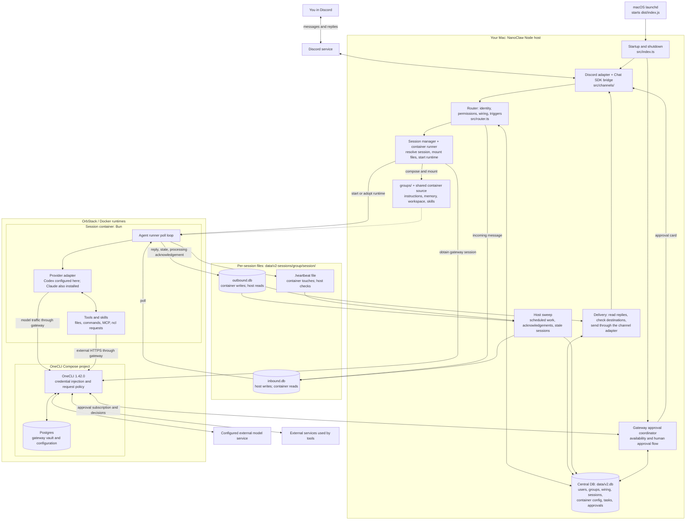

# System architecture

NanoClaw has two main programs: a Node host on your Mac and a Bun agent runner in each session container. OrbStack supplies Docker. OneCLI is a separate credential gateway with its own Postgres database.

## The boundaries to remember

- **Host:** decides which agent gets a message, starts runtimes, manages permissions and schedules, and delivers output.
- **Agent group:** persistent identity, workspace, memory, instructions, and container configuration. A group can have multiple sessions.
- **Session:** a conversation/runtime context resolved from the group, chat, thread, and isolation settings. It has its own inbound and outbound mailboxes.
- **Mailbox:** host/container messages travel through the two session databases. Each database has one writer. The heartbeat is a separate file.
- **Gateway:** holds credentials and controls external requests. Its Postgres database is separate from NanoClaw's central and session databases. A gateway outage closes agent admission even if Discord is connected.

## Where to read the code

| Question | Start here |
|---|---|
| What starts and shuts down? | [src/index.ts](../src/index.ts), [setup/lib/restart.sh](../setup/lib/restart.sh) |
| How does Discord become a NanoClaw message? | [Discord adapter](../src/channels/discord.ts), [Chat SDK bridge](../src/channels/chat-sdk-bridge.ts) |
| Who gets a message, and when does it trigger an agent? | [src/router.ts](../src/router.ts) |
| How are conversations and mailbox files resolved? | [src/session-manager.ts](../src/session-manager.ts) |
| How is a container created with mounts and gateway access? | [src/container-runner.ts](../src/container-runner.ts), [src/container-runtime.ts](../src/container-runtime.ts) |
| How are instructions and config prepared? | [src/project-doc-compose.ts](../src/project-doc-compose.ts), [src/group-init.ts](../src/group-init.ts), [src/container-config.ts](../src/container-config.ts) |
| What runs inside the container? | [Runner entry point](../container/agent-runner/src/index.ts), [poll loop](../container/agent-runner/src/poll-loop.ts), [providers](../container/agent-runner/src/providers/) |
| How do replies reach Discord? | [src/delivery.ts](../src/delivery.ts) |
| How are timers, retries, and stale sessions handled? | [src/host-sweep.ts](../src/host-sweep.ts) |
| How do OneCLI and approvals work? | [OneCLI adapter](../src/gateway-providers/onecli.ts), [approval coordinator](../src/gateway-approval-coordinator.ts), [gateway contract](../docs/gateway-seam.md) |
| How can I inspect and manage groups or tasks? | [CLI dispatcher](../src/cli/dispatch.ts), [CLI resources](../src/cli/resources/) |

Read the first eight rows in order for a message-processing walkthrough. For storage details, see [central DB](../docs/db-central.md) and [session DBs](../docs/db-session.md).
