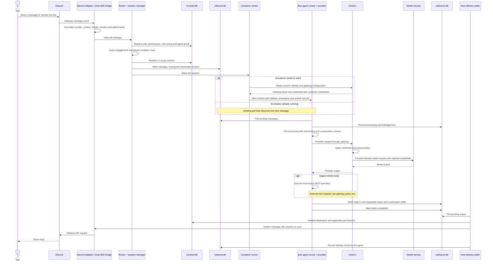
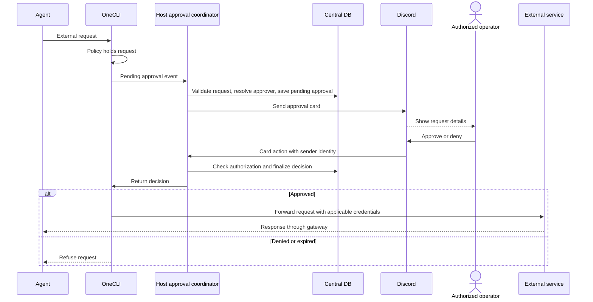

# End-to-end: a Discord message to an agent reply

This shows the normal triggered-message path. Routing may reject an unknown sender or an unauthorized user, or store a message without waking the agent when its engagement rules do not match.



The provider can stream output and use tools during a turn, so replies and acknowledgements can interleave. The host polls active sessions roughly every second and also sweeps sessions roughly every minute. It checks the heartbeat and processing state to detect stalled work.

## When an external request needs approval



Approval depends on the gateway policy and host rules; not every model or tool request shows a card. If the approval subscription fails, the host closes session admission and stops gateway-dependent running sessions until reconnection succeeds.

## Trace a failure without an AI assistant

| Last successful checkpoint | What to inspect next |
|---|---|
| Nothing starts | `logs/nanoclaw.error.log`: upgrade tripwire, startup backoff, gateway selection, Docker availability |
| Discord shows online but no agents start | OneCLI and Postgres health; gateway subscription/admission errors in the host error log |
| Discord receives a message but nothing routes | Adapter logs, user access, chat wiring, mention/engagement rules in the router |
| Message routed | Session `inbound.db`: confirm a `messages_in` row exists |
| Inbound row exists but no reply | Session `outbound.db`: inspect `processing_ack`; check runtime, heartbeat, provider and gateway errors |
| Outbound reply exists but Discord receives nothing | Delivery errors, destination validation, adapter/API failures |

Start with these read-only checks from the checkout:

```bash
tail -n 40 logs/nanoclaw.error.log
tail -n 60 logs/nanoclaw.log
docker compose -f "$HOME/.onecli/docker-compose.yml" ps
curl -fsS http://127.0.0.1:10254/v1/health
pnpm ncl sessions list
```

`ncl` needs the host to be running. To inspect the central database directly, use the in-tree wrapper:

```bash
pnpm exec tsx scripts/q.ts data/v2.db "SELECT id, agent_group_id, status, container_status FROM sessions"
```

For a particular session, use its actual mailbox path from `data/v2-sessions/` with the same wrapper. Schema and query examples are in [the debug skill](../.claude/skills/debug/SKILL.md) and [session database reference](../docs/db-session.md). Inspect data before changing it; do not delete a session or credential volume to diagnose a missing reply.
